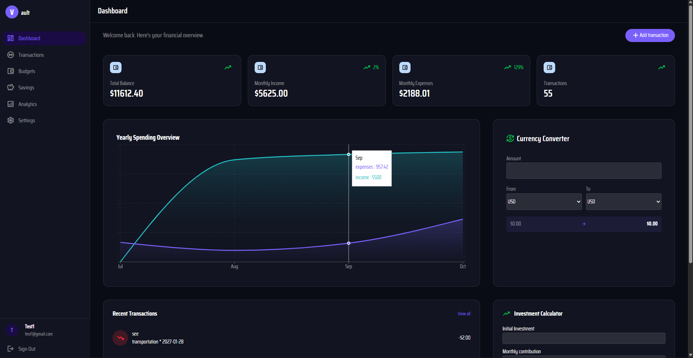
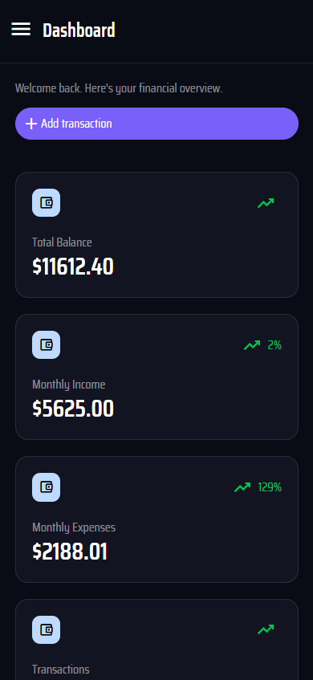
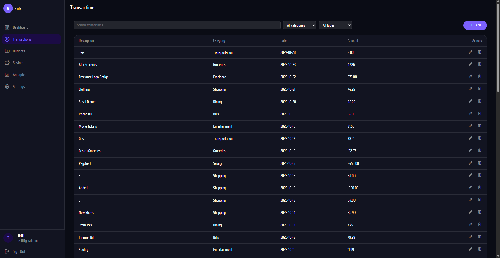
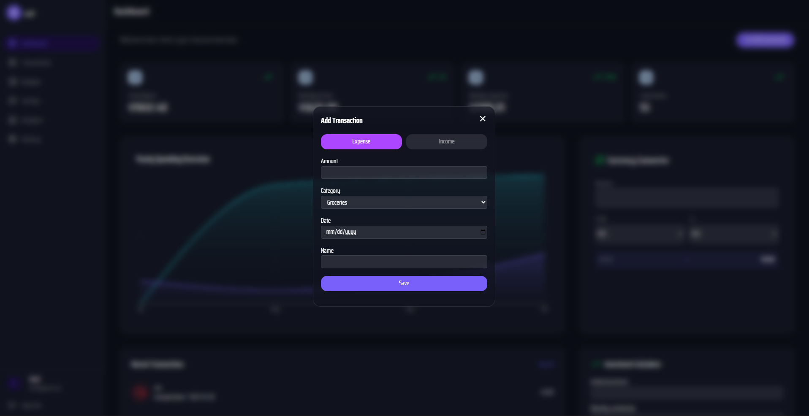
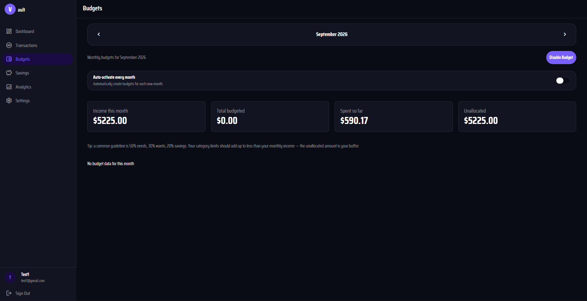
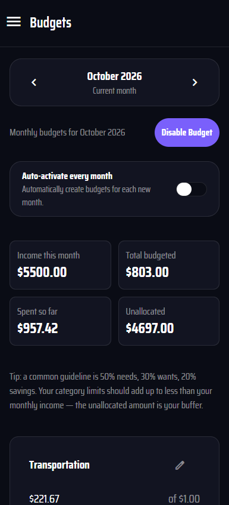
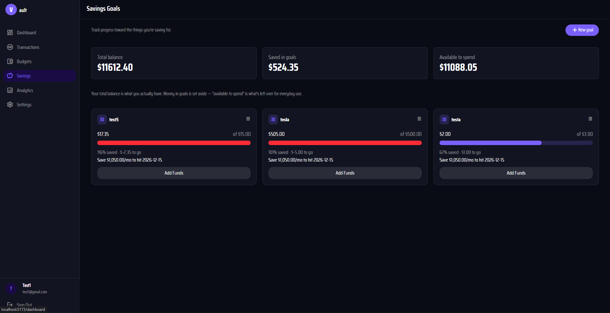
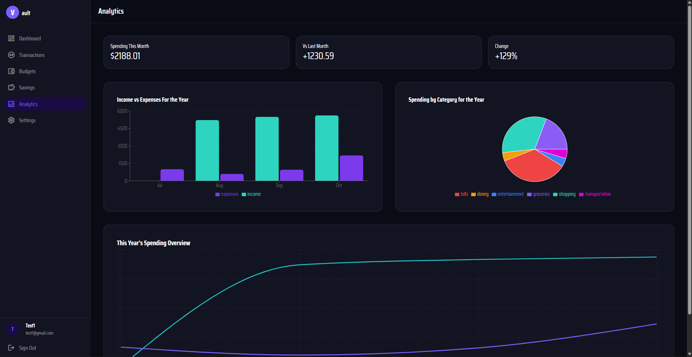
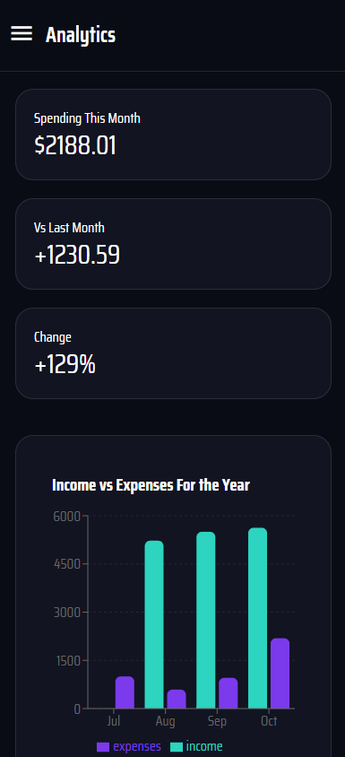
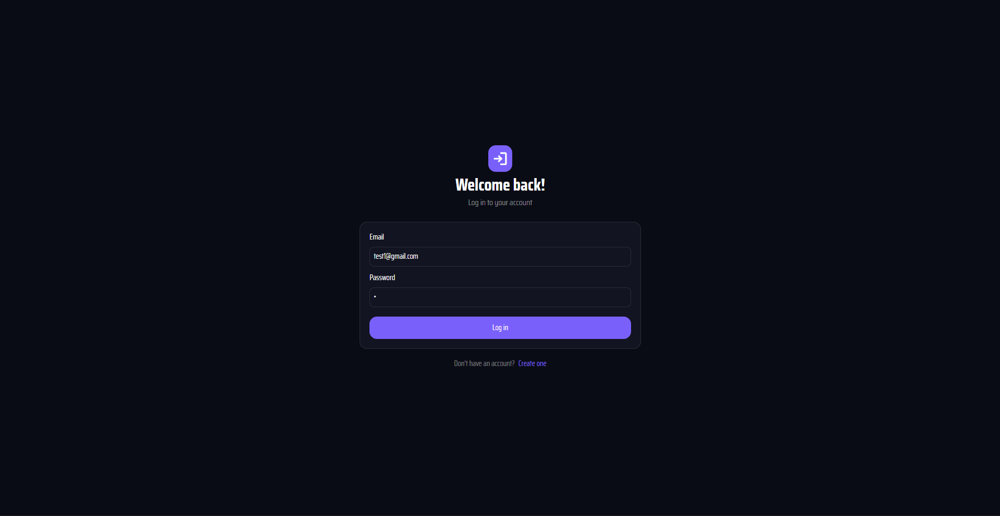

# FinTech — Personal Finance Dashboard

A responsive, full-stack personal finance web application for tracking transactions, managing monthly budgets, setting savings goals, and understanding spending habits through interactive visualizations.

**Project status:** In active development · Runs locally · Not yet deployed

> The screenshots show a development environment with synthetic/test data. Some values and unfinished interface elements are not representative of a production release.

## Preview



### Responsive dashboard

<table>
  <tr>
    <td width="72%"></td>
    <td width="28%"></td>
  </tr>
  <tr><td align="center"><em>Desktop</em></td><td align="center"><em>Mobile</em></td></tr>
</table>

## Features

### Transaction management

Track income and expenses, browse transaction history, search records, and filter by category or transaction type. The interface includes controls to add, edit, and delete entries.



<details>
<summary>View add-transaction form</summary>



</details>

### Monthly budgets

Navigate between months, configure category-level spending limits, and compare budgeted amounts with actual spending. The interface also includes an option for automatically activating budgets for new months.

<table>
  <tr>
    <td width="72%"></td>
    <td width="28%"></td>
  </tr>
</table>

### Savings goals

Create savings targets, track progress toward each goal, and view how much of the account balance is allocated to savings versus available for spending.



### Financial analytics

Explore monthly income versus expenses, category-level spending, yearly trends, and changes in spending compared with the previous month. Visualizations are built with Recharts.

<table>
  <tr>
    <td width="72%"></td>
    <td width="28%"></td>
  </tr>
</table>

### Authentication and account settings

The app includes registration and login interfaces, session-based authentication, and a settings page for profile information.

<details>
<summary>View login screen</summary>



</details>

### Additional dashboard tools

The dashboard also includes interfaces for currency conversion and investment calculations.

## Technology stack

| Layer | Technologies |
| --- | --- |
| Frontend | React, TypeScript, Vite |
| Styling | Tailwind CSS |
| State management | Zustand |
| Charts | Recharts |
| Backend | Node.js, Express.js, REST APIs |
| Database | MySQL |
| Authentication | Argon2, express-session, HTTP-only session cookies |
| Session storage | Redis |
| Version control | Git, GitHub |

## Architecture

```text
React + TypeScript + Tailwind CSS
              |
         REST API calls
              |
        Node.js / Express
              |
       +------+------+
       |             |
     MySQL         Redis
 Users, transactions,  Session storage
 budgets, savings goals
```

The frontend renders account-specific financial views and communicates with an Express API. MySQL stores application records, while Redis backs authenticated sessions. Passwords are hashed with Argon2.

## Running locally

**Prerequisites:** Node.js, npm, MySQL, and Redis.

1. Clone the repository.
2. Install the dependencies in the frontend and backend directories.
3. Configure local environment variables for MySQL, Redis, and session secrets. Do not commit `.env` files or credentials.
4. Initialize the database using the project's schema or migrations.
5. Start the backend and frontend using the npm scripts defined in their respective `package.json` files.

> Exact directory names, environment variable keys, and startup commands should be added after the repository structure is finalized.

## Current status and roadmap

This is a portfolio project under active development. The core interfaces shown above are implemented, but some functionality, demo data, and edge cases still need refinement. The project is not presented as production-ready.

**Planned improvements:**

- Complete unfinished flows and improve empty, loading, and error states.
- Refine budget calculations, validation, and display of over-budget categories.
- Add more realistic and consistent synthetic financial data for demos.
- Expand automated tests and accessibility checks.
- Deploy a public demo after the application is ready.
- Explore an analytics engineering extension using Python ELT, BigQuery, dbt models, and data quality tests. **These tools are planned, not part of the current implementation.**

## What this project demonstrates

- Building responsive interfaces for desktop and mobile
- Designing a multi-feature full-stack application
- Working with relational data and REST APIs
- Implementing authentication and server-side sessions
- Turning financial records into interactive charts and summary metrics

---

*Built as a personal software engineering portfolio project. All financial information shown in screenshots is sample data.*
